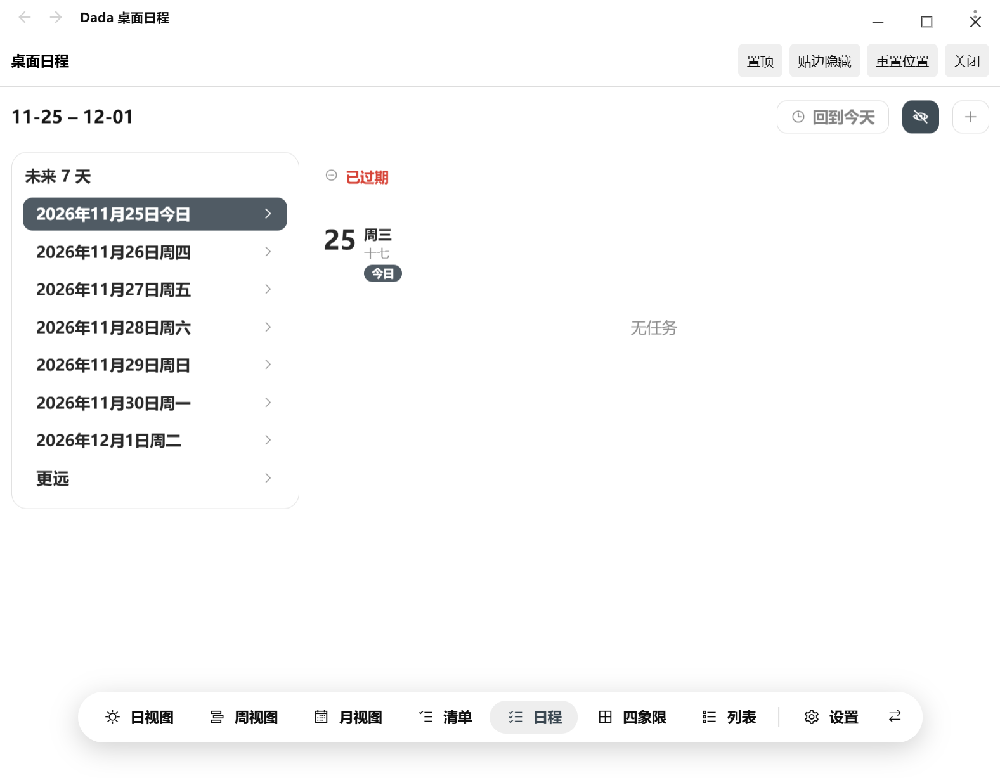

# Dada 桌面日程 · 非官方独立扩展

把 Dada Todo List 的任务界面放进 Obsidian 的独立桌面窗口，支持左右吸附、贴边收起和鼠标靠近展开。

这是 [Yuki-happyday](https://github.com/Yuki-happyday) 使用 Codex 辅助开发的个人实验项目，供交流和参考。任务界面与 Markdown 读写基于 [Plover 的 Dada Todo List](https://github.com/Plover-PY/obsidian-DadaTodoList) **0.12.2**，感谢原作者。原作者未参与本扩展的开发或维护。



## 功能

- 独立日程窗口：日、周、月、清单、日程、四象限和列表视图。
- 拖动最上方标题栏或第二行空白，保留系统按钮及双击最大化/还原。
- 可选置顶，Obsidian 主窗口最小化后仍可使用。
- 距左右边缘 16 个逻辑像素内，或部分越过边缘，松手后吸附。
- 开启隐藏后，鼠标离开约 600ms 收起为窄条；靠近窄条约 150ms 展开。
- 编辑任务、可见菜单和拖拽期间暂停收起；支持位置重置与打开状态恢复。

窗口依赖 Obsidian 运行，完全退出 Obsidian 时一起关闭。扩展不会启动另一份提醒服务。

## 安装

当前版本 **1.0.5**；最低 Obsidian **1.13.0**。仅在 Windows 桌面端完成验证。

1. 在仓库中安装并启用 Dada Todo List。当前界面和数据格式以其 0.12.2 版本为适配基线。
2. 从 [Releases](https://github.com/Yuki-happyday/dada-desktop-window/releases) 下载 `dada-desktop-window-1.0.5.zip`。
3. 将 ZIP 中的 `dada-desktop-window` 文件夹放入目标仓库的 `.obsidian/plugins/`。
4. 在 Obsidian 第三方插件设置中启用「Dada 桌面日程」。
5. 运行命令「Dada 桌面日程：打开桌面日程」，或点击左侧日历图标。

更新时保留插件目录中的 `data.json`。必须完整更新 `main.js`、`styles.css`、`manifest.json`、`ui.cjs` 和 `ui.css`；只替换旧式三个文件会缺少日程界面资源。目前使用 ZIP 手动安装，尚未提交 Obsidian 社区插件目录。

### 贴边使用

拖到左右边缘松手，再把鼠标移出窗口才会收起；鼠标仍停在窗口里时保持展开。吸附与隐藏是独立开关，可在扩展设置中调整；「重置位置」可找回窗口。

1.0.5 保留了个人使用阶段的一次性设置迁移：配置没有 `edgeHideConfigured` 标志时，会同时开启吸附与隐藏并写入标志。此后手动关闭的选择会保留。窗口位置、大小和置顶设置保留。正式集成时可考虑将这项行为改为安装引导。

扩展单独保存窗口配置，沿用已启用 Dada 的任务设置，任务仍写回同一批 Markdown 笔记。更新 Dada 不会覆盖本扩展文件；新配置和任务格式变化仍可能需要适配。卸载时停用并删除本扩展目录即可。

## 构建

本地和 CI 使用 Node.js 24，依赖版本由 `package-lock.json` 锁定。

```sh
npm ci
npm test
npm run build
```

构建输出在 `dada-desktop-window/`。该目录及运行配置不提交到 Git，安装包通过 Release 提供。

## 代码结构

| 模块 | 职责 |
| --- | --- |
| `src/desktop/main.js` | 独立插件入口、命令、设置、轻量启动及按需加载 |
| `src/desktop/DesktopWindowController.js` | 窗口创建、唤回、置顶、吸附、隐藏和清理 |
| `src/desktop/dock.js` | 屏幕工作区计算、越界吸附及收起/展开状态机 |
| `src/desktop/windowContent.js` | 启动恢复与普通笔记打开请求路由 |
| `src/desktop/ui.js` | 在最终窗口内挂载一次任务界面，管理样式与事件 |
| `src/core/` | 从上游适配的任务界面、读写与窗口归属处理 |

技术细节和上游集成建议见 [实现说明](docs/architecture.md)。

## 验证与限制

- 当前逻辑测试 10 项，覆盖边界、越界吸附、隐藏时序、配置迁移、原子保存和笔记路由。
- 开发时使用隔离 Obsidian 原生窗口，验证了 405/900 宽度、左右越界 90px、隐藏开关两种状态共 8 个用例。
- 左右收起与展开使用受控光标坐标验证；未完成的物理鼠标尝试未计作通过。
- 测试环境包含 Windows、Obsidian 1.15.1、Blue Topaz、Homepage 4.4.4、Dataview、编辑工具栏和单屏 175% 缩放。
- 未完成真实多显示器、其他操作系统及长期使用验收。Electron remote 和 Obsidian 工作区内部方法存在版本兼容风险。
- 完整 UI 已按需加载，但首次加载仍可能有短暂停顿；不能保证任意大型仓库或插件组合的性能。

桌面回归脚本需要独立测试仓库与调试实例，详见 [测试说明](docs/testing.md)。CI 只运行逻辑测试和生产构建。

## 来源与许可

基于 Plover 的 Dada Todo List：标签 `0.12.2`，提交 `327b08caf3dff7406976cfea11e22b5133e66c1f`。

保留上游 [MIT 许可证](LICENSE)及作者版权声明。第三方依赖与改动说明见 [THIRD-PARTY-NOTICES.txt](THIRD-PARTY-NOTICES.txt) 和 [THIRD-PARTY-LICENSES.txt](THIRD-PARTY-LICENSES.txt)。

欢迎通过 Issue 交流。这个仓库由扩展维护者处理反馈，原作者不承担本扩展的兼容或维护工作。
